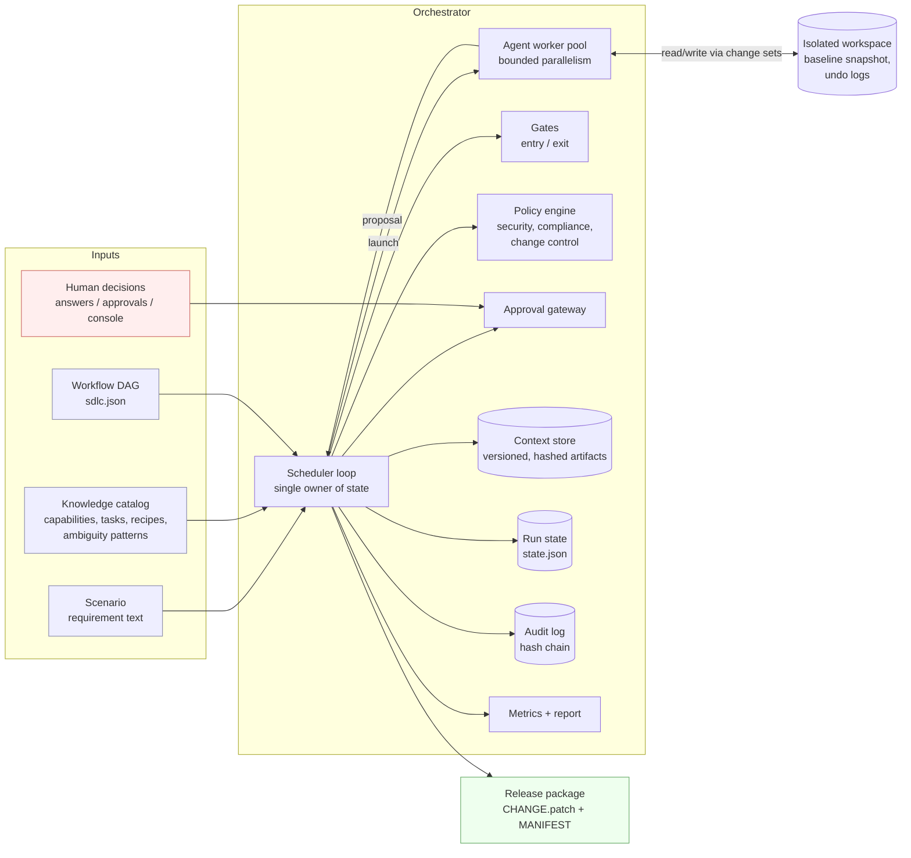
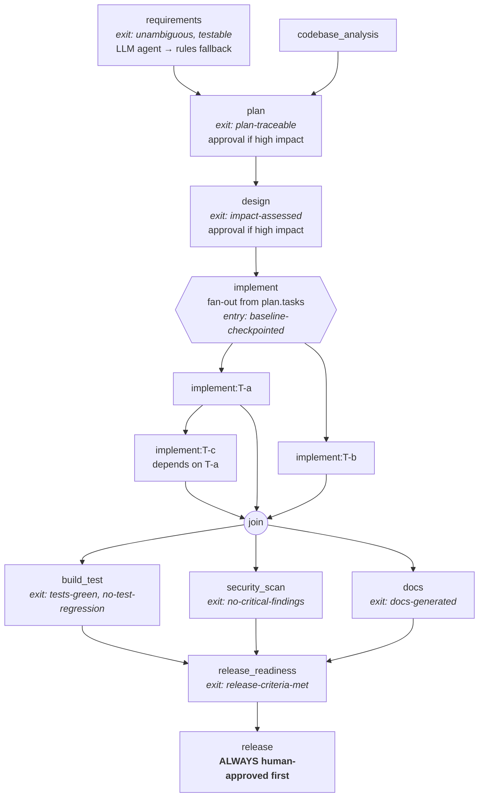
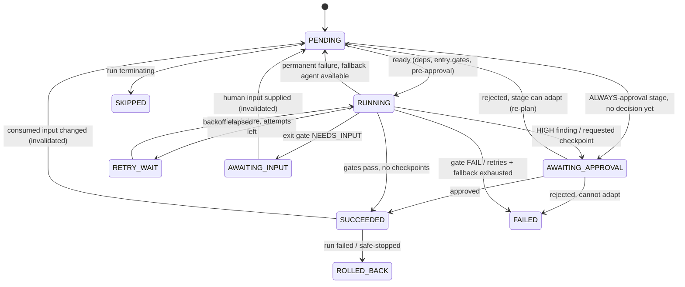

# Architecture

## 1. Principles

1. **Agents propose, the orchestrator disposes.** An agent returns a proposal: artifacts, decisions, findings and requested checkpoints. Only the orchestrator applies gates, policy and approvals and commits results. No agent can approve its own work or skip a gate.
2. **Autonomy is bounded and explicit.** What runs without a human, what needs a human, and what is never allowed are all declared: in the workflow definition (`approval`), in policy-as-code (severity) and in the release step (human-applied patch).
3. **Everything is reproducible and attributable.** Every output is versioned and content-hashed. Every decision records the exact input versions it was based on. Every event goes into a tamper-evident audit chain.
4. **Fail safe.** Failures, stops and rejections leave the workspace in a known state (baseline snapshot or per-stage undo). Releases are packaged atomically. An orchestrator error fails closed.

## 2. Components



| Component | Code | Responsibility |
|---|---|---|
| Scheduler | `engine/Orchestrator` | Owns all run state on a single thread. Decides readiness, launches agents, accepts or rejects results, handles failures, invalidation, pause/resume and safe-stop. |
| Workflow graph | `workflow/WorkflowGraph`, `StageSpec`, `resources/workflows/sdlc.json` | Declarative DAG: dependencies, gates, approval mode, retry budget, timeout, fallback agent, whether the stage mutates code. Validated for cycles and unknown references at load and after every runtime expansion. |
| Agents | `agents/*` | Stateless, idempotent workers that read inputs through `AgentContext`, which records lineage. |
| Context store | `context/ContextStore` | Immutable artifact versions (`artifacts/<key>@vN.json`) with SHA-256 over canonical JSON, checked again on every read. |
| Gates | `engine/Gates` | Named deterministic predicates (`requirements-unambiguous`, `plan-traceable`, `tests-green`, `no-test-regression`, `release-criteria-met`, …). |
| Policy | `governance/PolicyEngine` | Rules evaluated on the plan, on every change set before it is written, and on the complete code diff before release. |
| Approvals | `governance/FileApprovalGateway`, `ConsoleApprovalGateway` | Human decisions, either asynchronous (file, resume) or interactive. Never auto-approves. |
| Workspace | `workspace/Workspace` | Copy-on-start working tree. Atomic change sets, persisted per-stage undo logs, named snapshots, diff. |
| Observability | `observability/AuditLog`, `Metrics`, `RunReport` | Hash-chained audit, per-run and aggregate reliability metrics, human-readable report. |
| Knowledge | `knowledge/catalog.json`, `knowledge/recipes/` | What can be built and how, as reviewable data under change control. |

## 3. The SDLC workflow graph



* **Parallel paths:** `requirements` ∥ `codebase_analysis`; implementation tasks within a wave; `build_test` ∥ `security_scan` ∥ `docs`.
* **Synchronisation:**
  * `plan` joins the requirements and codebase branches.
  * The `implement` placeholder becomes a join barrier over its generated stages.
  * `release_readiness` joins the three verification branches.
* **Runtime graph expansion:** once `design` succeeds, the `implement` placeholder is expanded from the current plan, one stage per task, with the plan's task dependencies preserved. If the plan changes later, the expansion is rebuilt (§5).
* **File-ownership safety:** the planner serialises any two tasks that touch the same file, so parallel implementation stages never race on a file. The workspace also serialises writes.

## 4. Control loop and stage lifecycle

Each scheduler iteration does the following:

1. **Safe-stop check:** kill switch (`runs/<id>/STOP`), total-attempt budget, active-time budget.
2. **Invalidation and re-planning:** any finished or paused stage whose consumed artifact hashes no longer match the latest versions is reset. So is everything downstream of it (§5).
3. **Pending approvals:** asked again, once per session.
4. **Fan-out expansion** from the current plan.
5. **Launch** every ready stage, up to `maxParallel`. A stage is ready when:
   * its dependencies `SUCCEEDED`,
   * its entry gates pass, and
   * if its approval mode is `ALWAYS`, a human has approved *before* it acts.
6. **Handle one completion:**
   * *failure*:
     * `TRANSIENT` → retry with exponential backoff while within `maxAttempts`;
     * otherwise → fallback agent if declared;
     * otherwise → undo the stage and fail the run.
   * *result*:
     1. exit gates (`NEEDS_INPUT` pauses the run, `FAIL` fails it);
     2. policy findings (`CRITICAL` safe-stops; `HIGH` requires approval);
     3. commit artifacts and decision lineage;
     4. human checkpoints.
7. **Timeouts:** an overdue attempt is cancelled and counted as a transient failure.



Run outcomes:

* `SUCCEEDED`
* `AWAITING_INPUT` (resumable)
* `AWAITING_APPROVAL` (resumable)
* `FAILED` (rolled back)
* `SAFE_STOPPED` (rolled back)
* `REJECTED` (a non-adaptable checkpoint was refused)

`state.json` is written atomically after every transition, so a run can be resumed by a different process later. Time spent paused for humans is excluded from the active-time latency metric.

## 5. Context, lineage and dynamic re-planning

* Agents read inputs only through `AgentContext.input/optionalInput`. Each read records `artifact key → content hash`, and an optional input that is absent is recorded as `absent`.
* That map is stored on the stage (`consumed`) and on every decision the stage makes (`basedOn`). This is the **decision lineage**: for any decision, the report shows exactly which version of which artifact it rested on.
* **Invalidation rule:** at the top of every loop iteration, a stage whose recorded hashes differ from the current ones is stale. The stale stage and its transitive downstream are reset to `PENDING`.
  * If any of them already changed the workspace, the workspace is restored to the baseline snapshot first, and every mutating stage is re-run.
  * The result is therefore always equivalent to a clean execution of the current plan.
* Re-executions are bounded (`maxReExecutions`, default 3 per stage). This prevents oscillation.
* Upstream outputs change in three ways:
  1. a human supplies new input (`human.clarifications`);
  2. a human rejects a checkpoint, which is recorded as `human.constraints`. A stage in an adaptable phase (requirements, planning, design) re-executes under the new constraint; any other stage fails the run;
  3. a stage is re-run, for example after a retry, and produces different content.

The ambiguous scenario exercises all of this. The answers arrive and the requirements are invalidated. The plan then contains a task that processes personal data, which triggers a privacy review. The DPO rejects it, the constraint is recorded, the plan is re-executed without that capability, and the graph is re-expanded with 2 tasks instead of 3.

## 6. Governance

### Policy guardrails (policy-as-code, `PolicyEngine`)

| Rule | Severity → response | Where evaluated |
|---|---|---|
| SEC-001 hard-coded secrets / private keys | CRITICAL → safe-stop + rollback | each change set, code diff |
| SEC-005 TLS bypass / `setAccessible(true)` | CRITICAL | change set, code diff |
| CHG-001 path escapes workspace; CHG-005 path outside src/test/resources/docs | CRITICAL | change set |
| SEC-002 process execution, SEC-003 unsafe deserialization, SEC-004 weak crypto / `java.util.Random` | HIGH → `security-review` | change set, code diff |
| CMP-001 personal data in code (IP, e-mail, geo) | HIGH → `privacy-review` | change set, code diff |
| CMP-002 plan task tagged `personal-data` | HIGH → `privacy-review` *before any code exists* | plan |
| CHG-002 build/CI files, CHG-003 dependency changes, QA-001 deleting tests, CHG-006 blast radius (>15 files or >600 lines per change set) | HIGH → `change-control` | change set, plan |
| CHG-004 breaking API change | HIGH → `design-review` | plan |

HIGH findings always require approval, whatever the workflow configuration says. Configuration cannot switch governance off.

### Human checkpoints

| Checkpoint | Trigger | Kind |
|---|---|---|
| `design/design-review` | design changes the API contract or the stored-data format | output review (agent proposes, human accepts) |
| `<stage>/privacy-review`, `security-review`, `change-control` | a HIGH policy finding on that stage's output | output review |
| `release/release` | always | **pre-action approval**: the release agent does not run until a human approves |

* Approval keys are `<stage>/<checkpoint>`, and `*/<checkpoint>` acts as a wildcard.
* The approver must be a named human. `agent`, `system`, `auto` and blank are refused (separation of duties).
* A missing decision means **pending, never approved**. A closed stdin in interactive mode is also pending.
* Every request lists its evidence, as artifact versions and hashes, and every decision is a lineage record.

### Autonomy boundaries

| Agents do autonomously | Requires a human | Never happens |
|---|---|---|
| Interpret requirements, plan, design, edit the isolated workspace, compile, test, scan, document, assemble release evidence | Resolve blocking ambiguity; accept contract/data changes; accept HIGH policy findings; release | Modify the repository, push, deploy, approve its own work, bypass a gate or a CRITICAL finding |

## 7. Reliability controls

| Failure | Control |
|---|---|
| Transient agent error (I/O, flaky dependency, LLM timeout) | Bounded retries per stage (`maxAttempts` ≤ 10), exponential backoff capped at 5 s. A failed attempt's workspace changes are undone before the retry. |
| Primary agent broken or unavailable (e.g. LLM output invalid) | `fallbackAgent` with its own retry budget. "Unavailable" (no model configured) is counted separately from failures. |
| Hung agent | Per-stage timeout → cancel → transient failure. The workspace build (Gradle) is a separate process with a hard kill. |
| Change set does not apply (code drifted) | Anchors must match exactly once. Otherwise it is a permanent conflict: nothing is written and the change set is validated in full before the first write. |
| Verification fails (compile/test/scan/readiness) | Exit gate fails → run `FAILED` → workspace restored to baseline. Stages that had succeeded are marked `ROLLED_BACK`. |
| Policy CRITICAL, operator stop, budget exhausted | Safe-stop: launch nothing new, drain in-flight work, roll back, persist, report. |
| Orchestrator bug or audit write failure | Fail closed: safe-stop and roll back, then rethrow. |
| Process crash | State and per-stage undo logs are persisted before every mutation. `agentic resume <id> --recover` undoes interrupted attempts exactly and reschedules them. Artifacts and state are written atomically (temp file + rename). |
| Partial release | Packaging uses a staging directory and an atomic rename. On error, the compensating action deletes the staging directory. |

## 8. Observability

* **Audit trail** (`audit.jsonl`): one JSON event per transition, for example:
  * `RUN_STARTED`, `STAGE_STARTED`, `ENTRY_GATE`, `EXIT_GATE`
  * `POLICY_FINDING`, `APPROVAL_REQUESTED`, `APPROVAL_DECIDED`, `ARTIFACT_STORED`, `DECISION_RECORDED`
  * `RETRY_SCHEDULED`, `FALLBACK_INVOKED`, `STAGE_INVALIDATED`, `REPLAN`, `GRAPH_EXPANDED`
  * `ROLLBACK`, `SAFE_STOP`, `RUN_PAUSED`, `RUN_FINISHED`

  Each entry has `hash = SHA-256(prevHash + SHA-256(canonical entry))`, so editing, deleting or reordering any entry breaks verification (`agentic verify-audit`). The chain continues across resumes, and the orchestrator refuses to append to a broken chain.
* **Metrics:**
  * Per run (`metrics.json`): attempts, retries, fallbacks, rollbacks, re-executions, approvals requested and rejected, policy findings, MTTR, active end-to-end latency, and per-stage durations.
  * Aggregate across runs (`agentic metrics`): success rate, retries per run and per stage, rollback frequency, MTTR, and p50/p95 end-to-end latency.
* **Report** (`REPORT.md`): requirement interpretation, ambiguities and assumptions; plan and waves; design and impact; execution table; decision lineage; validation (tests, security, release checks, traceability matrix, diff); metrics; audit status. It is regenerated at every pause and at the end.

## 9. Agents

| Agent | Reads | Produces | Notes |
|---|---|---|---|
| `requirements-llm` → fallback `requirements-rules` | scenario text, `human.clarifications` | `requirements` | The model only *classifies* against the catalog. Its reply is validated (JSON, known ids only), and the artifact is always built by code. |
| `codebase-analysis` | workspace | `codebase_index` | Types, type-level reference graph (both directions), test count, routes, capabilities already present (catalog evidence). |
| `planner` | requirements, index, `human.constraints` | `plan` | Reuse vs build vs exclude. Pulls in prerequisites, serialises shared files, groups tasks into waves. Plan-level policy. |
| `design` | plan, index, requirements | `design` | API and data changes, impacted files, ripple types (existing code referencing changed types), risks. Requests `design-review`. |
| `implementation` | plan task, design | `impl.<task>` + workspace change | Recipe → change set → preview → policy → atomic apply with undo log. |
| `build-test` | workspace | `test_report` | Copies the workspace, builds and tests it with the repository's pinned Gradle wrapper in a separate process (timeout, credential-like environment variables removed), parses the JUnit XML. Network/dependency failures are transient; compile errors and failing tests are not. |
| `security-scan` | workspace diff | `security_report` | Independent scan of the complete code diff (`src/`), separate from the per-task checks. |
| `docs` | requirements, plan, design, source | `docs/API.md`, `docs/changes/<scenario>.md` | Generated from the source of truth. |
| `release-readiness` | everything | `release_readiness` | Checklist, requirement → task → test traceability, diff, risks. |
| `release` | readiness | `release/CHANGE.patch`, `MANIFEST.json` | Only after human approval. Never pushes. |

**Where an LLM fits.** `LlmClient` is the seam. In the default offline mode, requirement classification falls back to the rules agent, and implementation replays *reviewed recipes*: change sets stored as data in `knowledge/recipes`. An LLM code generator would be another recipe source behind the same pipeline (preview → policy → apply → gates → approval). The governance around agents does not depend on how a proposal was produced. That is the property this design optimises for.

## 10. The URL shortener service

```mermaid
flowchart LR
  C[HTTP client] --> F[RequestIdFilter<br/>request id, nosniff,<br/>body size limit 413]
  F --> I[RateLimitInterceptor<br/>token bucket on create → 429]
  I --> R[LinkController<br/>@RestController: HTTP ↔ service]
  R -.errors.-> X[ApiExceptionHandler<br/>@RestControllerAdvice:<br/>uniform JSON errors]
  R --> S[ShortenerService<br/>create / resolve / stats,<br/>idempotency, collision retry]
  S --> V[UrlValidator<br/>scheme, credentials, private IPs,<br/>redirect loops, IDN]
  S --> G[CodeGenerator<br/>CSPRNG base62, alias rules]
  S --> P[LinkRepository port]
  P --> M[InMemoryLinkRepository]
  P --> J[JournalLinkRepository<br/>write-ahead JSONL, Jackson 3,<br/>replay, torn-tail tolerant]
  H[StorageHealthIndicator] --> P
  A[Actuator<br/>/actuator/health/liveness,<br/>/readiness, /metrics] --> H
```

The service is a **Spring Boot 4.0** application (Spring Framework 7, Jakarta EE 11, Jackson 3, Java 17).
The domain (`core/`, `store/`) is plain Java with no Spring annotations. It is wired in `ShortenerConfiguration`,
so the business rules are unit-tested without a Spring context and would carry over to any framework.
Configuration is a validated `@ConfigurationProperties` record (`shortener.*` in `application.yml`,
overridable as `SHORTENER_*` environment variables); an invalid value fails startup.

Design notes, with more in the engineering summary:

* **302, not 301**, with `Cache-Control: private, max-age=0`. Browsers do not cache the redirect, so every click is counted, and the brownfield expiry can take effect.
* **HEAD is not counted** as a click, because link unfurlers and crawlers use it.
* **No IP addresses are stored.** The client address is used in memory only, as the rate-limit key. The policy engine flags that use, and a human privacy review approved it.
* **Idempotency-Key**: a replay returns the original link with 200. Concurrent duplicates create exactly one link; this is tested with 32 threads.
* **Persistence**: a journal record is written and flushed before the in-memory state changes. A torn last line is skipped on replay. Corruption anywhere else fails startup loudly. Each record carries a format version.
* The service talks only to the `LinkRepository` port, so a relational or key-value store (e.g. Spring Data JPA on Postgres) can replace the journal without touching the domain or the API.
* **Operations:** Actuator liveness and readiness probes, where readiness includes the storage health check, so a load balancer stops routing to an instance whose journal is failing. Micrometer counters (`shortener.links.created`, `shortener.redirects`, `shortener.rate_limited`), ECS-format JSON logs with the request id in the MDC, and graceful shutdown.
